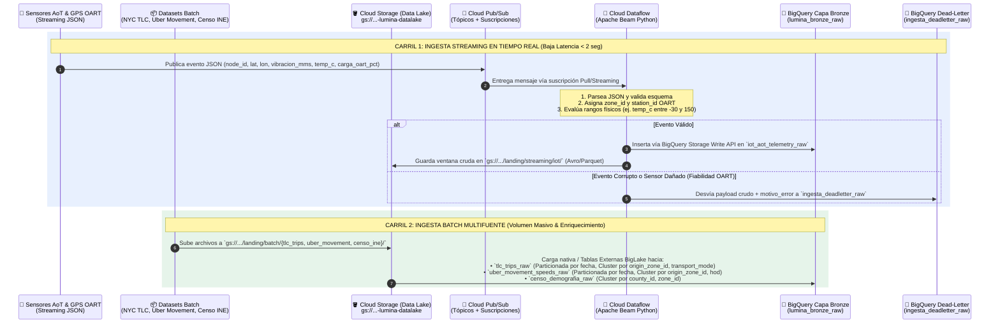

<div style="background: linear-gradient(135deg, #E8F0FE 0%, #FCE8E6 35%, #FEF7E0 70%, #CEEAD6 100%); padding: 28px; border-radius: 16px; border-left: 8px solid #4285F4; font-family: 'Google Sans', Roboto, sans-serif;">
  <h1 style="color: #1A73E8; margin: 0;">🏙️ Proyecto Parte 1 (P1): Blueprint y Diseño de Ingesta / Almacenamiento</h1>
  <h2 style="color: #3C4043; margin-top: 6px; font-weight: 500;">Caso de Estudio: DataLandia Metropolitan — Autoridad de Tránsito Unificada "Lumina" (Smart Mobility)</h2>
  <p style="color: #5F6368; font-size: 14px; margin-top: 10px; margin-bottom: 0;">
    <b>Curso:</b> Big Data &nbsp;|&nbsp;
    <b>Nube Oficial:</b> Google Cloud Platform (GCP) + Open Source Standards &nbsp;|&nbsp;
    <b>Hito:</b> Entrega 1 — Proyecto Parte 1 (P1 - 25%) &nbsp;|&nbsp;
    <b>Documento Complementario:</b> <a href="./Avance1_Examen_Sustentacion_Tecnica_Economica_Resiliencia.md"><b>Examen de Sustentación (E - 25%)</b></a>
  </p>
</div>

---

## 📋 Índice Ejecutivo del Entregable (P1)

1. **[Supuestos del Proyecto: Premisas de Negocio, Operacionales y Técnicas](#1-supuestos-del-proyecto-premisas-de-negocio-operacionales-y-técnicas)**
   - 1.1. Premisas e Hipótesis de Negocio (Lumina y Movilidad en DataLandia)
   - 1.2. Premisas Técnicas, de Conectividad y de Plataforma Cloud
2. **[Contexto y Diagnóstico Técnico de DataLandia (Iniciativa Lumina)](#2-contexto-y-diagnóstico-técnico-de-datalandia-iniciativa-lumina)**
   - 2.1. Diagnóstico de la Fragmentación y Principios Rectores del RFP Lumina
3. **[Integración Multifuente: Conectar, Modelar y Cruzar Datos Heterogéneos](#3-integración-multifuente-conectar-modelar-y-cruzar-datos-heterogéneos)**
   - 3.1. Clasificación de las 4 Fuentes Oficiales y Flujos Operativos
   - 3.2. Modelo de Entidad-Relación y Llaves Maestras de Cruce (`zone_id`, `county_id`, `station_id`, `time_bucket_15m`)
   - 3.3. Matriz de Cruce Multifuente para las 4 Verticales de Negocio de Lumina
4. **[Diagrama de Arquitectura End-to-End en GCP](#4-diagrama-de-arquitectura-end-to-end-en-gcp)**
   - 4.1. Vista General con Separación de Carriles (Batch vs. Real-Time) y Capas Transversales (Redes y Seguridad)
   - 4.2. Flujo Detallado de Ingesta en Tiempo Real vs. Lotes (Diagrama de Secuencia)
5. **[Definición de Ingesta y Storage (Lakehouse Medallion + NoSQL Operacional)](#5-definición-de-ingesta-y-storage-lakehouse-medallion--nosql-operacional)**
   - 5.1. Selección y Justificación de Mecanismos de Captura (Streaming y Batch)
   - 5.2. Selección y Justificación de Motores de Almacenamiento según Volumen, Velocidad y Variedad
   - 5.3. Diseño Físico de la Capa Bronze/Raw (Particionamiento, Clusterización, Formatos Abiertos y DLQ)
   - 5.4. Gobernanza, Calidad de Datos (Knowledge Catalog DQ) y Seguridad desde la Ingesta
   - 5.5. Transición y Orquestación entre Capas en BigQuery (Bronze → Silver → Gold): Managed Airflow vs. Alternativas
6. **[Implementación Práctica de la Capa de Ingesta y Storage (Scripts en GCP)](#6-implementación-práctica-de-la-capa-de-ingesta-y-storage-scripts-en-gcp)**

---

## 1. Supuestos del Proyecto: Premisas de Negocio, Operacionales y Técnicas

Antes de profundizar en el diseño físico y lógico de la arquitectura, se establecen explícitamente los **supuestos e hipótesis operacionales** que guían y restringen las decisiones tecnológicas para **DataLandia Metropolitan** y la autoridad **Lumina**:

### 1.1. Premisas e Hipótesis de Negocio

1. **Unificación Institucional y Tarifaria:** Se asume que las **12 agencias históricamente fragmentadas** consolidan su operación bajo Lumina. Se establece una política de tarifa única multimodal integrada (`OART_TRAIN`, `EV_MINIVAN`, `BUS_RAPID`, `BIKE_SHARE`), demostrando analíticamente un costo por kilómetro significativamente menor al de un auto privado en congestión.
2. **Volumen de Población y Demanda:** DataLandia cuenta con **9.25 millones de habitantes** distribuidos en **8 condados** y **260 zonas de movilidad**. Se proyectan **~2.5 millones de viajes diarios** en transporte integrado, con picos de demanda entre las 07:00–09:00 y las 17:30–19:30.
3. **El Cuello de Botella de 24 km/h (15 mph):** El auto particular experimenta una velocidad media de 24 km/h en hora punta en los ejes arteriales. La red ferroviaria **OART** cuenta con una cobertura del **89% a menos de 8 km** del hogar de los ciudadanos, pero adolece de un déficit de *primera y última milla* que la plataforma resolverá mediante optimización multimodal.
4. **Acuerdo de Nivel de Servicio (SLA) de Negocio:** La toma de decisiones para ruteo en vivo y asignación de flotas exige una latencia end-to-end **$< 2\text{ segundos}$**. Los tableros ejecutivos para planificación de recursos deben actualizarse diariamente antes de las 05:00 AM.
5. **Restricción FinOps:** El costo de infraestructura analítica y de datos no debe superar los **$\$0.00015\text{ USD}$ por viaje procesado**.

### 1.2. Premisas Técnicas, de Conectividad y de Plataforma Cloud

1. **Dispositivos IoT y Protocolos (F3):** Se asumen desplegados **~50,000 nodos sensores** (*Array of Things* urbanos y telemetría de trenes OART). Cada dispositivo emite telemetría periódica cada 1 a 5 segundos bajo formato serializado `JSON` / `Protobuf` vía protocolo seguro `MQTT / TLS 1.3` hacia *Cloud Pub/Sub*. Tasa base de ingesta: **~15,000 msg/seg**, con capacidad elástica para soportar picos de hasta **120,000 msg/seg** en eventos masivos.
2. **Tolerancia a Sensores Defectuosos:** Dado el ambiente ferroviario y urbano hostil, se asume una tasa de error de hasta **2.5%** en tramas IoT (valores nulos, sensores descalibrados o paquetes truncados). La plataforma debe aislar estos fallos en una **Dead-Letter Queue (DLQ)** sin interrumpir el flujo productivo.
3. **Cadencia y Granularidad de Fuentes Batch:**
   - **NYC TLC (F1):** Cargas incrementales diarias con cierres mensuales consolidados (~15 GB/mes en formato `Parquet`).
   - **Uber Movement (F2):** Matrices de tiempos y velocidades agregadas por pares origen-destino y hora del día (`hod`), actualizadas diariamente (~250 MB/día).
   - **Censo INE (F4):** Dimensión lentamente cambiante (SCD Tipo 2) con refresco anual o semestral (~50 MB en `CSV/GeoJSON`).
4. **Topología Cloud Serverless & Open Source First:** Toda la solución se despliega en **Google Cloud Platform (GCP)** priorizando servicios serverless gestionados (`Cloud Dataflow`, `BigQuery`, `Cloud Storage`, `Cloud Run`, `Managed Airflow`) para eliminar la administración de máquinas virtuales y evitar el *vendor lock-in* mediante estándares abiertos (**Apache Beam, Apache Iceberg, Apache Parquet**).
5. **Perímetro de Seguridad Cerrado (Zero Public Exposure):** No existen IPs públicas en las capas de procesamiento ni almacenamiento. Todo el tráfico interno fluye a través de **Private Google Access**, **Private Service Connect (PSC)** y perímetros protegidos por **VPC Service Controls**.
6. **Cumplimiento de Privacidad y Retención:** Todo identificador de usuario o pasajero se anonimiza mediante función hash criptográfica (`SHA-256 + Salt`) antes de pasar a la capa Silver. Los datos crudos en BigQuery Bronze tienen una política de retención automática de **90 días** (`partition_expiration_days = 90`) para optimizar costos de almacenamiento.

---

## 2. Contexto y Diagnóstico Técnico de DataLandia (Iniciativa Lumina)

La región metropolitana de **DataLandia** alberga a más de **9 millones de residentes** distribuidos en **8 condados** y operaba históricamente con **12 agencias de tránsito fragmentadas**. Pese a que el **89% de la población vive a menos de 8 km de una estación de la red ferroviaria OART** (*Organización de Tránsito Rápido de DataLandia*), la carencia de integración de *"primera y última milla"* ha llevado a una dependencia crítica del automóvil particular, reduciendo la velocidad promedio en hora punta a tan solo **24 km/h (15 mph)**.

Bajo el mandato de la **Autoridad de Tránsito Lumina (2025)** y el **RFP para el Back-End Inteligente**, nuestra arquitectura resuelve los requerimientos técnicos bajo tres principios rectores:

| Principio del RFP Lumina                                        | Implementación en nuestra Arquitectura Google Cloud Platform (GCP)                                                                                                                                                                                                                                                                                                                               |
| :-------------------------------------------------------------- | :------------------------------------------------------------------------------------------------------------------------------------------------------------------------------------------------------------------------------------------------------------------------------------------------------------------------------------------------------------------------------------------------ |
| **1. Estándares de Código Abierto (Open Source First)** | Uso de **Apache Beam** (ejecutado serverless en *Cloud Dataflow*), **Apache Spark / Apache Iceberg** (*BigLake + Dataproc Serverless*), formatos abiertos **Apache Parquet / Avro** en *Cloud Storage* y APIs basadas en **OpenAPI / REST / WebSockets** en *Cloud Run*. Evita el *vendor lock-in* y permite portar el código a otras regiones metropolitanas. |
| **2. Propiedad de Datos de Lumina e IP Reutilizable**     | Separación estricta entre la **Infraestructura como Código / Pipelines (IP de nuestra consultora)** parametrizada vía `.env` y el **Data Lakehouse en GCS + BigQuery (Propiedad de Lumina)** gobernado con *Knowledge Catalog* y *Sensitive Data Protection (DLP)*.                                                                                                             |
| **3. Soporte a las 4 Verticales Críticas**               | **V1. Decisiones en Tiempo Real** (< 2 seg latencia), **V2. Planes Diarios de Recursos** (Batch nocturno/predictivo), **V3. Informes Operativos OLAP** (Costo/km y velocidad Lumina vs. particular > 24 km/h), y **V4. Mantenimiento Proactivo PdM** (Telemetría IoT de nodos y vías OART).                                                                             |

---

## 3. Integración Multifuente: Conectar, Modelar y Cruzar Datos Heterogéneos

El reto central de **Proyecto Parte 1 (P1)** es diseñar una estrategia sólida para conectar y cruzar fuentes masivas que nacen desconectadas (viajes transaccionales, matrices de velocidad vial, telemetría de sensores físicos e indicadores demográficos censales).

### 3.1. Clasificación de las Fuentes de Datos (Los 4 Datasets Base + Eventos en Vivo)

Hemos homologado las **4 fuentes oficiales del caso** junto con los eventos transaccionales de la App Lumina dentro de un catálogo unificado:

|      ID      | Fuente de Datos / Dataset de Referencia                                                                             | Naturaleza y Velocidad                                                                    | Formato Origen → Destino                                                | Volumen Estimado (DataLandia 9M hab.)                                              | Rol en el Negocio de Lumina                                                                                                                                                                       |
| :----------: | :------------------------------------------------------------------------------------------------------------------ | :---------------------------------------------------------------------------------------- | :----------------------------------------------------------------------- | :--------------------------------------------------------------------------------- | :------------------------------------------------------------------------------------------------------------------------------------------------------------------------------------------------ |
| **F1** | **Viajes Multimodales y Taxis***(Ref: NYC TLC Trip Record Data)*                                            | **Batch Incremental + Micro-batch**(Histórico mensual + cierres cada 15 min)       | `Parquet` / `CSV` → **GCS Bronze (`Parquet`) + BigQuery**   | ~2.5 millones viajes/día(~75M filas/mes, ~15 GB/mes)                              | Calcular el **costo por kilómetro ($/km)**, tarifas, propinas, duración real, ocupación y comparar eficiencia **Lumina vs. vehículo personal**.                                   |
| **F2** | **Tiempos de Viaje y Velocidad entre Zonas***(Ref: SF Caltrain / Uber Movement Data)*                       | **Batch Diario + Actualización Horaria**(Matrices Origen-Destino por franja)       | `CSV` / `JSON` → **GCS Bronze + BigQuery**                    | ~65,000 pares O-D por hora(~1.5M filas/día, ~250 MB/día)                         | Establecer el **baseline de congestión (24 km/h en hora punta)**, detectar cuellos de botella viales y alimentar el ruteador multimodal con tiempos de tránsito.                          |
| **F3** | **Telemetría de Nodos IoT e Infraestructura OART***(Ref: Array of Things - AoT Urban Sensors + GPS Flota)* | **Streaming Tiempo Real**(Eventos continuos cada 1 a 5 segundos)                    | `JSON` / `Protobuf` vía MQTT/HTTPS → **Cloud Pub/Sub**       | ~50,000 sensores y vehículos activos → **~15,000 msg/seg** (~1.2 TB/día)  | Monitorear **vibración de rieles OART, temperatura de frenos/motores, ruido urbano, calidad del aire y carga de vagones** para **Mantenimiento Predictivo (PdM)** y alertas en vivo. |
| **F4** | **Censo de Población, Vivienda y Demografía***(Ref: Censo INE Demografía y Población)*                  | **Batch Estático / Slowly Changing Dimension (SCD Tipo 2)**                        | `CSV` / `Shapefile (GeoJSON)` → **GCS Bronze + BigQuery Geo** | ~9.2 millones de habitantes agregados en **260 Zonas y 8 Condados** (~50 MB) | Identificar **adultos mayores en suburbios sin auto**, **jóvenes lejos de estaciones OART**, densidad laboral y equidad tarifaria para **Planes Diarios de Recursos**.         |
| **F5** | **Solicitudes en Vivo App Lumina, Clima y Eventos Ciudad**                                                    | **Streaming Tiempo Real + API Polling**(Peticiones de viaje + Google Geocoding API) | `JSON` → **Cloud Pub/Sub + Cloud Run**                          | ~3,000 solicitudes/seg en hora punta (~200 GB/día)                                | Emparejar pasajeros en tiempo real (*ride-pooling* + tren OART + bicicleta/globo) y ajustar flota ante conciertos, lluvias o cierres viales.                                                    |

---

### 3.2. Estrategia de Modelado y Llaves Maestras de Integración (Cómo Unimos las Fuentes)

En estado crudo, **NYC TLC** usa `PULocationID / DOLocationID`, **Uber Movement** usa polígonos `sourceid / dstid` con `hod` (*hour of day*), **Array of Things** usa coordenadas `(lat, lon)` por `node_id`, y el **Censo INE** usa códigos político-administrativos (`comuna / distrito`).

Para poder **cruzar las 4 fuentes sin pérdida de rendimiento**, diseñamos una **Capa de Armonización Geoespacial y Temporal (Master Data Management en Capa Silver/Gold)** basada en **3 Llaves Canónicas**:

1. **Llave Espacial Maestra (`zone_id` y `county_id` + Polígono `GEOGRAPHY` / H3 Index):**
   - Dividimos el territorio metropolitano de **DataLandia** en **8 Condados (`CNT-01` a `CNT-08`)**, **260 Zonas de Movilidad (`ZDL-001` a `ZDL-260`)** y **85 Estaciones OART (`OART-ST-01` a `OART-ST-85`)**.
   - **Mapeo directo:**
     - `NYC TLC (PULocationID / DOLocationID)` $\longrightarrow$ se mapea directamente a `origin_zone_id` y `dest_zone_id` (`ZDL-XXX`).
     - `Uber Movement (sourceid / dstid)` $\longrightarrow$ se homologa al mismo catálogo `origin_zone_id` y `dest_zone_id` (`ZDL-XXX`).
     - `Array of Things (lat, lon)` $\longrightarrow$ se cruza espacialmente en BigQuery mediante `ST_CONTAINS(zona.geometria_poligono, ST_GEOGPOINT(sensor.lon, sensor.lat))` (o índice hexagonal **Uber H3 resolución 8**) asignándole su `zone_id` y la estación `station_id` OART más cercana (`ST_DISTANCE <= 8000m`).
     - `Censo INE (manzana/comuna)` $\longrightarrow$ se agrega a nivel de `zone_id` y `county_id`.
2. **Llave Temporal Armonizada (`date_partition` + `time_bucket_15m` + `hour_of_day`):**
   - Todo timestamp de evento (`pickup_datetime` en TLC, `timestamp` en AoT IoT) se trunca a ventanas de 15 minutos (`TIMESTAMP_TRUNC(ts, MINUTE)` en bloques de 15m) y hora del día (`EXTRACT(HOUR FROM ts)` = `0..23`), permitiendo hacer `JOIN` exacto con la columna `hod` (*Hour of Day*) de **Uber Movement**.
3. **Llave de Activo y Agencia (`agency_id` + `vehicle_or_node_id` + `transport_mode`):**
   - Vincula las **12 agencias heredadas** (`AG-01` a `AG-12`) con los modos multimodales de Lumina (`OART_TRAIN`, `EV_MINIVAN`, `BUS_RAPID`, `BIKE_SHARE`, `FERRY`, `HOT_AIR_BALLOON`, `PERSONAL_CAR_BENCHMARK`).

```mermaid
erDiagram
    DIM_GEOGRAFIA_DATALANDIA ||--o{ FACT_VIAJES_MULTIMODALES : "origin_zone_id / dest_zone_id"
    DIM_GEOGRAFIA_DATALANDIA ||--o{ FACT_VELOCIDAD_ZONAS_UBER : "origin_zone_id / dest_zone_id"
    DIM_GEOGRAFIA_DATALANDIA ||--o{ FACT_TELEMETRIA_IOT_AOT : "zone_id / station_id (ST_CONTAINS)"
    DIM_GEOGRAFIA_DATALANDIA ||--|| DIM_DEMOGRAFIA_CENSO : "zone_id / county_id"
    DIM_TIEMPO_HORA ||--o{ FACT_VIAJES_MULTIMODALES : "date_id + hour_of_day"
    DIM_TIEMPO_HORA ||--o{ FACT_VELOCIDAD_ZONAS_UBER : "date_id + hod (hour_of_day)"
    DIM_TIEMPO_HORA ||--o{ FACT_TELEMETRIA_IOT_AOT : "time_bucket_15m"

    DIM_GEOGRAFIA_DATALANDIA {
        string zone_id PK "Ej: ZDL-001 a ZDL-260"
        string county_id "8 Condados (CNT-01..CNT-08)"
        string county_name "Nombre del Condado"
        string nearest_oart_station_id "Estación OART < 8km"
        geography zone_polygon "Polígono WKT / GeoJSON"
        string h3_res8_index "Índice Hexagonal H3"
    }

    DIM_DEMOGRAFIA_CENSO {
        string zone_id PK, FK "Llave de cruce espacial"
        string county_id "Condado"
        int64 poblacion_total "Total residentes (~9M total)"
        float64 pct_adulto_mayor_65 "Población suburbana sin auto"
        float64 pct_jovenes_18_34 "Jóvenes pro-transporte público"
        float64 ingreso_familiar_medio_usd "Nivel socioeconómico"
        float64 pct_vivienda_menos_8km_oart "Cobertura 89% OART"
        float64 indice_deficit_primera_milla "Score de necesidad de Minivans/Bikes"
    }

    FACT_VIAJES_MULTIMODALES {
        string trip_id PK "ID único de viaje (NYC TLC adaptado)"
        timestamp pickup_ts "Inicio del viaje"
        timestamp dropoff_ts "Fin del viaje"
        string origin_zone_id FK "PULocationID homologado"
        string dest_zone_id FK "DOLocationID homologado"
        string agency_id "1 de las 12 agencias integradas"
        string transport_mode "OART, Minivan, Bus, Personal_Benchmark"
        float64 trip_distance_km "Distancia recorrida en km"
        float64 total_fare_usd "Costo total del viaje"
        float64 cost_per_km_usd "Métrica clave: Costo / km"
        int64 passenger_count "Ocupación del vehículo"
    }

    FACT_VELOCIDAD_ZONAS_UBER {
        string movement_id PK "Registro O-D horario"
        date travel_date "Fecha de observación"
        int64 hod FK "Hour of Day (0-23)"
        string origin_zone_id FK "sourceid homologado"
        string dest_zone_id FK "dstid homologado"
        float64 mean_travel_time_sec "Tiempo promedio Uber Movement"
        float64 avg_speed_kmh "Velocidad promedio (Baseline: 24 km/h)"
        boolean is_peak_congestion "True si avg_speed_kmh <= 24.0"
    }

    FACT_TELEMETRIA_IOT_AOT {
        string event_id PK "UUID evento sensor"
        timestamp event_ts "Timestamp en milisegundos"
        string node_id "ID Nodo Array of Things / Tren OART"
        string zone_id FK "Zona asignada por Geo-Join"
        string station_id "Estación o tramo OART"
        float64 vibration_mms "Vibración riel/chasis (mm/s)"
        float64 temperature_c "Temperatura componente (°C)"
        float64 sound_db "Nivel de ruido urbano (dB)"
        int64 passenger_load_pct "Porcentaje ocupación vagón OART"
        string anomaly_status "NORMAL, WARNING, CRITICAL_PDM"
    }
```



---

### 3.3. Matriz de Cruce Multifuente por Vertical de Negocio

| Vertical de Lumina                                             | Fuentes que se Cruzan (`JOIN`)                                                                                   | Lógica Analítica del Cruce                                                                                                                                                                | Resultado / Acción Accionable                                                                                                                                                                                   |
| :------------------------------------------------------------- | :----------------------------------------------------------------------------------------------------------------- | :------------------------------------------------------------------------------------------------------------------------------------------------------------------------------------------ | :--------------------------------------------------------------------------------------------------------------------------------------------------------------------------------------------------------------- |
| **1. Decisiones en Tiempo Real**                         | **F5 (App Solicitudes)** + **F3 (IoT/GPS OART)** + **F2 (Uber Movement Velocidad)**              | Cruza la ubicación actual del pasajero (`origin_zone_id`) con la carga en vivo del tren OART más cercano (`passenger_load_pct < 85%`) y la velocidad vial actual (`avg_speed_kmh`). | Si la calle está congestionada (`< 24 km/h`), despacha una **Minivan compartida o Bicicleta** hacia la estación **OART** más cercana (< 8 km) en lugar de hacer todo el trayecto por carretera. |
| **2. Planes Diarios de Recursos**                        | **F4 (Censo INE)** + **F1 (Histórico Viajes TLC)** + **F2 (Uber Movement)**                     | Cruza zonas con alto `% de adultos mayores (>65 años)` o `jóvenes (18-34)` que viven a `< 8 km de OART` pero tienen baja tasa de viajes en primera milla.                           | Pre-posiciona a las 05:00 AM flotas de **Minivans accesibles** en suburbios envejecidos y **Bicicletas/Buses** en zonas juveniles antes de la hora punta.                                            |
| **3. Informes Operativos Bajo Demanda (OLAP)**           | **F1 (Viajes TLC)** + **F2 (Uber Movement)** + **F4 (Censo INE)**                                | Compara el `cost_per_km_usd` y tiempo puerta-a-puerta de los viajes multimodales de Lumina frente al costo de conducir un auto particular en tráfico de `24 km/h`.                     | Dashboard Ejecutivo en Data Studio / Cloud Run demostrando que **Lumina ahorra un 38% en costo/km y reduce el tiempo de viaje en 27%** frente al vehículo privado.                                      |
| **4. Mantenimiento y Planificación de Infraestructura** | **F3 (Sensores AoT Vibración/Temp)** + **F1 (Volumen de Viajes)** + **F2 (Cuellos de Botella)** | Correlaciona picos de vibración (`vibration_mms > 7.5`) y temperatura (`> 85°C`) con la frecuencia de paso de trenes OART y zonas donde `avg_speed_kmh < 18 km/h`.                  | Dispara órdenes de **Mantenimiento Preventivo (PdM)** nocturno antes de que falle un cambio de vía OART y prioriza inversión de capital en los condados con mayor congestión.                          |

---

## 4. Diagrama de Arquitectura End-to-End en GCP

En estricto cumplimiento con el feedback docente, la arquitectura divide de forma limpia y explícita el **Carril de Tiempo Real (Streaming)** del **Carril por Lotes (Batch)**, e integra visualmente las **Capas Transversales de Seguridad / Gobernanza** y de **Redes Empresariales**:

### 4.1. Arquitectura General: Carriles Batch vs. Real-Time y Capas Transversales

```mermaid
flowchart TB
    %% ==========================================
    %% FUENTES DE DATOS
    %% ==========================================
    subgraph FUENTES["🌐 1. FUENTES DE DATOS MULTIMODALES (DATALANDIA METROPOLITAN)"]
        direction LR
        subgraph FUENTES_RT["⚡ Fuentes Streaming / Eventos"]
            S_IOT["📡 Sensores IoT (Array of Things)\n& Telemetría Trenes OART / GPS\n(JSON/Protobuf • 15k a 120k msg/s)"]
            S_APP["📱 App Móvil Lumina\nPeticiones en Vivo, Check-in & Pagos\n(JSON • WebSockets/REST)"]
        end
        subgraph FUENTES_BATCH["📦 Fuentes Batch / Periódicas"]
            B_TLC["🚕 NYC TLC Trip Records (F1)\nViajes, Tarifas, Distancias, Duración\n(Parquet/CSV • Cierre Diario/Mensual)"]
            B_UBER["🗺️ Uber Movement Speeds (F2)\nMatrices Velocidad O-D por Franja (24 km/h)\n(CSV/JSON • Batch Diario)"]
            B_CENSO["👥 Censo Demográfico INE (F4)\nDemografía 8 Condados & Cobertura OART\n(CSV/GeoJSON • Dimensión SCD2)"]
        end
    end

    %% ==========================================
    %% CARRIL REAL-TIME (STREAMING LANE)
    %% ==========================================
    subgraph RT_LANE["⚡ 2. CARRIL DE TIEMPO REAL (REAL-TIME STREAMING LANE — Latencia < 2s)"]
        direction LR
        PUBSUB[["📨 Cloud Pub/Sub\nTópicos Ingesta Global:\n• lumina-iot-telemetry-topic\n• lumina-trip-requests-topic\n(Buffer elástico con DLQ integrada)"]]
        DATAFLOW["🌊 Cloud Dataflow (Apache Beam Python)\n• Ventanas deslizantes y fijas (1m / 5m)\n• Geo-enriquecimiento espacial (ST_CONTAINS)\n• Detección de anomalías en sensor OART\n• Desvío a Dead-Letter Queue (DLQ)"]
        BT_HOT[("⚡ Cloud Bigtable / Memorystore\nEstado en Vivo Sub-10ms:\nGPS Flota, Posición Trenes & Nodos IoT")]
    end

    %% ==========================================
    %% CARRIL BATCH (BATCH PROCESSING LANE)
    %% ==========================================
    subgraph BATCH_LANE["⚙️ 3. CARRIL POR LOTES (BATCH & LAKEHOUSE LANE — Volumen & Analítica)"]
        direction LR
        GCS_RAW[("🪣 Cloud Storage (Data Lake)\ngs://lumina-datalake-raw\nFormatos Abiertos (Parquet, Avro, CSV)\nLifecycle: Standard ➔ Nearline ➔ Archive")]
        BQ_LOAD["🔄 BigQuery Load Jobs\n& Storage Transfer Service\n(Carga gratuita Parquet en GCS)"]
        
        subgraph MEDALLION["🏛️ BigQuery Lakehouse Medallion"]
            direction TB
            BQ_BRONZE[("🥉 Capa BRONZE: lumina_bronze_raw\nTablas Raw Particionadas + Tabla DLQ\n(Partition Expiration = 90 días FinOps)")]
            BQ_SILVER[("🥈 Capa SILVER: lumina_silver_clean\nTablas Limpias, Deduplicadas (QUALIFY),\nHomologadas a zone_id + Hash SHA-256 PII")]
            BQ_GOLD[("🥇 Capa GOLD: lumina_gold_governed\nModelo Estrella OLAP (Fact/Dim),\nMétricas Costo/km vs 24 km/h & Feature Store")]
        end
    end

    %% ==========================================
    %% ORQUESTACIÓN TRANSVERSAL
    %% ==========================================
    subgraph ORQUESTACION["🎼 ORQUESTADOR EMPRESARIAL DE PLATAFORMA"]
        AIRFLOW["🎼 Managed Airflow (Apache Airflow)\nDAGs de Ingesta, Sensores de Llegada en GCS,\nEjecución de Transiciones Bronze ➔ Silver ➔ Gold\ny Orquestación de Modelos Analíticos"]
    end

    %% ==========================================
    %% CAPAS TRANSVERSALES DE REDES Y SEGURIDAD
    %% ==========================================
    subgraph TRANSVERSAL_SEGURIDAD["🔒 CAPA TRANSVERSAL: SEGURIDAD, IDENTIDAD Y GOBERNANZA"]
        direction LR
        CATALOG["🔍 Knowledge Catalog\nCatálogo Unificado, Glosario de Negocio,\nLinaje End-to-End y Reglas de Calidad (SLA >= 95%)"]
        DLP["🛡️ Sensitive Data Protection (DLP)\nInspección Automática PII, Pseudonimización\nSHA-256 + Salt y Enmascaramiento Dinámico"]
        IAM_SEC["🔑 Cloud IAM, CMEK & Column-Level Security (CLS)\nControl de Acceso basado en Roles (RBAC),\nRow-Level Security (RLS) por Condado/Agencia"]
    end

    subgraph TRANSVERSAL_REDES["🌐 CAPA TRANSVERSAL: REDES Y CONECTIVIDAD EMPRESARIAL"]
        direction LR
        VPC_SC["🛡️ VPC Service Controls (Perímetro Seguro)\nAislamiento total contra exfiltración de datos"]
        PGA["🔗 Private Google Access & Private Service Connect (PSC)\nCero tráfico hacia internet pública para servicios de datos"]
        ARMOR["🧱 Cloud Armor & Cloud NAT\nProtección DDoS, WAF para APIs e inspección perimetral"]
    end

    %% ==========================================
    %% CAPA DE CONSUMO Y EXPOSICIÓN
    %% ==========================================
    subgraph EXPOSICION["🚀 4. CAPA DE CONSUMO, ANALÍTICA Y SERVICIOS"]
        direction LR
        CR_API["🌐 Cloud Run BFF (FastAPI / WebSockets)\nAPIs REST para App Lumina:\nRuteo Multimodal, Despacho y Alertas"]
        DATA_STUDIO["📊 Data Studio & BigQuery BI Engine\nDashboards Ejecutivos y Operativos:\n• Costo/km Lumina vs. Auto Particular (24 km/h)\n• Índice de Servicio en Suburbios y Cobertura OART"]
        AGENT_PLATFORM["🤖 Agent Platform & BigQuery ML\n• Modelos Predictivos de Demanda Diaria\n• Mantenimiento Predictivo (PdM) de Vías OART\n• Agentes Autónomos de Optimización de Flota"]
    end

    %% ==========================================
    %% CONEXIONES Y FLUJOS DE DATOS
    %% ==========================================
    %% Streaming Flow
    S_IOT -->|"MQTT / TLS 1.3"| PUBSUB
    S_APP -->|"HTTPS / Eventos"| PUBSUB
    PUBSUB -->|"Suscripción Streaming"| DATAFLOW
    DATAFLOW -->|"Low Latency State (<10ms)"| BT_HOT
    DATAFLOW -->|"Storage Write API (Stream)"| BQ_BRONZE
    DATAFLOW -.->|"Dump Crudo de Respaldo"| GCS_RAW

    %% Batch Flow
    B_TLC -->|"Upload Batch / SFTP"| GCS_RAW
    B_UBER -->|"API Ingest / CSV"| GCS_RAW
    B_CENSO -->|"Shapefile / CSV"| GCS_RAW
    GCS_RAW -->|"Load Jobs (Sin costo de cómputo)"| BQ_LOAD
    BQ_LOAD --> BQ_BRONZE

    %% Orquestación de Transición de Capas BigQuery
    AIRFLOW ==>|"Orquesta DAG Ingesta Batch"| BQ_LOAD
    AIRFLOW ==>|"DAG Transición Bronze ➔ Silver"| BQ_SILVER
    AIRFLOW ==>|"DAG Agregación Silver ➔ Gold"| BQ_GOLD
    AIRFLOW ==>|"Orquesta Reentrenamiento ML"| AGENT_PLATFORM

    %% Transición Interna Medallion
    BQ_BRONZE -.->|"Deduplicación & Limpieza"| BQ_SILVER
    BQ_SILVER -.->|"Modelado Estrella & Métricas"| BQ_GOLD

    %% Exposición y Consumo
    BT_HOT -->|"Ubicación Vehículos en Vivo"| CR_API
    BQ_GOLD -->|"Sub-second BI Cache"| DATA_STUDIO
    BQ_GOLD -->|"Métricas & Features"| AGENT_PLATFORM
    BQ_GOLD -->|"Consultas RLS/CLS"| CR_API

    %% Relaciones de Gobierno y Redes (Transversal)
    CATALOG -.- BATCH_LANE
    CATALOG -.- RT_LANE
    DLP -.- BQ_SILVER
    IAM_SEC -.- EXPOSICION
    VPC_SC -.- RT_LANE
    VPC_SC -.- BATCH_LANE
```



---

### 4.2. Flujo Detallado de Ingesta en Tiempo Real vs. Lotes (Diagrama de Secuencia)

Para visualizar con precisión cómo operan los mecanismos de captura y aterrizaje en la **Capa de Ingesta y Storage**, el siguiente diagrama de secuencia muestra el recorrido exacto del dato desde las 4 fuentes hasta las tablas particionadas y clusterizadas en **BigQuery Bronze** y **Cloud Storage**:



---

## 5. Definición de Ingesta y Storage (Lakehouse Medallion + NoSQL Operacional)

### 5.1. Selección y Justificación de Mecanismos de Captura (Streaming vs. Batch)

La arquitectura de Lumina adopta un patrón **Kappa/Lambda Unificado (Lakehouse)** donde el motor de procesamiento (**Apache Beam sobre Cloud Dataflow**) permite reutilizar la misma lógica de validación tanto en flujos continuos (*Streaming*) como en cargas masivas (*Batch*), complementado por carga directa a través de **Cloud Storage + BigQuery Load/BigLake**:

| Mecanismo de Captura en GCP                                                                                                          | Tecnología Abierta Subyacente                                                                                                                     | Fuentes que Captura                                                                                                                                                                                             | Justificación Técnica para DataLandia (Escala y Resiliencia)                                                                                                                                                                                                                                                                                                                                                                                                                                                                                                                  |
| :----------------------------------------------------------------------------------------------------------------------------------- | :------------------------------------------------------------------------------------------------------------------------------------------------- | :-------------------------------------------------------------------------------------------------------------------------------------------------------------------------------------------------------------- | :------------------------------------------------------------------------------------------------------------------------------------------------------------------------------------------------------------------------------------------------------------------------------------------------------------------------------------------------------------------------------------------------------------------------------------------------------------------------------------------------------------------------------------------------------------------------------ |
| **1. Ingesta Streaming Basada en Eventos:**`Cloud Pub/Sub` + `Cloud Dataflow`                                              | **Apache Beam SDK (Python)** + protocolo HTTP/gRPC (compatible con Kafka API)                                                                | • **F3:** Sensores urbanos *Array of Things* y telemetría de trenes OART.<br/>• **F5:** Solicitudes de viaje en vivo y GPS de minivans/buses.                                                       | • **Auto-escalado instantáneo:** Soporta picos masivos (ej. eventos masivos pasando de 5,000 a 120,000 msg/seg) sin aprovisionar servidores.<br/>• **Tolerancia a fallos de sensores OART:** Si un sensor de vía envía tramas corruptas o valores imposibles, el patrón **Side-Output / Dead-Letter Queue (DLQ)** en Apache Beam aísla el registro defectuoso en `ingesta_deadletter_raw` sin detener jamás el pipeline.<br/>• **Exactly-Once Processing:** Garantiza que ningún cobro de viaje ni alerta de mantenimiento se duplique. |
| **2. Ingesta Batch Masiva y Periódica:**`Cloud Storage (GCS)` + `BigQuery Storage Write / Load Jobs` + `Cloud Run Jobs` | Formatos columnares abiertos **Apache Parquet**, **CSV** y **GeoJSON** orquestados con **Managed Airflow** | • **F1:** Millones de viajes históricos (*NYC TLC Trip Records*).<br/>• **F2:** Matrices horarias de velocidad (*SF Uber Movement*).<br/>• **F4:** Datos censales y polígonos (*Censo INE*). | • **Desacoplamiento Storage/Compute:** Los archivos crudos aterrizan primero en un bucket regional de bajo costo (`gs://...-lumina-datalake`) organizados por partición Hive (`source=.../year=YYYY/month=MM/`).<br/>• **Cero costo por ingesta batch en BigQuery:** Los *Load Jobs* desde GCS hacia BigQuery en formato Parquet son gratuitos en cómputo de carga y aprovechan compresión *Snappy* (reduciendo hasta 80% el tamaño en disco frente a CSV).                                                                                 |
| **3. Enriquecimiento Geocodificado Asíncrono:**`Pub/Sub` + `Cloud Run` + `Google Geocoding API`                         | Python + REST JSON + Caché de Zonas en BigQuery                                                                                                   | • Direcciones de origen/destino ingresadas en texto libre o reportes de incidentes viales.                                                                                                                     | • Convierte direcciones textuales o coordenadas crudas en `zone_id` y coordenadas normalizadas, usando la credencial `GeoAPI` del entorno.                                                                                                                                                                                                                                                                                                                                                     |

---

### 5.2. Selección y Justificación de Motores de Almacenamiento

No existe un único motor de base de datos que resuelva eficientemente tanto la lectura en $<10\text{ ms}$ para ubicar un vehículo en el mapa como el escaneo analítico de cientos de millones de viajes históricos. Por ello, definimos una **arquitectura de almacenamiento políglota centrada en un Data Lakehouse**:

| Capa / Rol de Almacenamiento                                                              | Motor Seleccionado en GCP                                                                                                | Tipo de Almacenamiento                                                                                                                                | Fuentes / Datos Almacenados                                                                                                                                                                                                                             | Justificación por Volumen, Velocidad y Variedad                                                                                                                                                                                                                                                                                                                                                                                                                                                                                             |
| :---------------------------------------------------------------------------------------- | :----------------------------------------------------------------------------------------------------------------------- | :---------------------------------------------------------------------------------------------------------------------------------------------------- | :------------------------------------------------------------------------------------------------------------------------------------------------------------------------------------------------------------------------------------------------------ | :------------------------------------------------------------------------------------------------------------------------------------------------------------------------------------------------------------------------------------------------------------------------------------------------------------------------------------------------------------------------------------------------------------------------------------------------------------------------------------------------------------------------------------------- |
| **A. Data Lake Crudo e Inmutable (Landing & Archive)**                              | **Google Cloud Storage (GCS)**                                                                                     | **Object Storage Distribuido** (Formatos abiertos: *Parquet, Avro, JSONL, GeoJSON*)                                                           | Copia inmutable de **F1 (TLC)**, **F2 (Uber Movement)**, **F3 (AoT dumps)** y **F4 (Censo)**.                                                                                                                                   | • **Variedad y Volumen ilimitado:** Almacena datos estructurados, semi-estructurados y geoespaciales a $\$0.020/\text{GB-mes}$ (Standard).<br/>• **Políticas de Ciclo de Vida (Lifecycle):** Mueve automáticamente archivos crudos de $>30\text{ días}$ a *Nearline* ($\$0.010/\text{GB}$), $>90\text{ días}$ a *Coldline* ($\$0.004/\text{GB}$) y $>365\text{ días}$ a *Archive* ($\$0.0012/\text{GB}$).                                                                                      |
| **B. Data Lakehouse y Data Warehouse Analítico (Medallion: Bronze, Silver, Gold)** | **Google BigQuery + BigLake (Apache Iceberg)**                                                                     | **Enterprise Data Warehouse / Lakehouse Columnar Serverless** con soporte nativo **GIS (`GEOGRAPHY`)** y **ML (`BigQuery ML`)** | • **Bronze (`lumina_bronze_raw`):** 5 tablas crudas + DLQ.<br/>• **Silver (`lumina_silver_clean`):** Tablas limpias, deduplicadas y geo-homologadas.<br/>• **Gold (`lumina_gold_governed`):** Esquema Estrella OLAP y predicciones ML. | • **Velocidad Analítica (OLAP) y Escala Petabyte:** Procesa consultas sobre cientos de millones de viajes en segundos gracias a su almacenamiento columnar *Capacitor* y motor distribuido *Dremel*.<br/>• **BigQuery GIS nativo:** Permite cruzar coordenadas IoT con polígonos de los 8 condados (`ST_CONTAINS`, `ST_DISTANCE`) sin servidores externos.<br/>• **Integración con Apache Iceberg (BigLake):** Cumple el requisito de *Open Source* del RFP permitiendo leer tablas abiertas directamente desde GCS. |
| **C. Almacenamiento Operacional de Baja Latencia (Hot State / Real-Time Serving)**  | **Cloud Bigtable** *(Series de tiempo / Estado IoT)* + **Cloud Memorystore for Redis** *(Caché sub-ms)* | **NoSQL Wide-Column** (compatible con *Apache HBase*) + **In-Memory Key-Value**                                                         | • Última posición GPS de cada vehículo de las 12 agencias.<br/>• Últimos 15 min de telemetría por `node_id` OART.<br/>• Caché de rutas activas.                                                                                                        | • **Velocidad extrema (Baja Latencia):** Mientras BigQuery es ideal para analítica (latencia de $\sim 0.5\text{ a }2\text{ seg}$), el Front-End móvil de Lumina necesita consultar la ubicación del autobús o tren en **$< 5\text{ a }10\text{ milisegundos}$** a decenas de miles de lecturas por segundo (**QPS**). Bigtable y Redis absorben esa carga operativa sin encarecer los *slots* de BigQuery.                                                                                                      |

---

### 5.3. Diseño Físico de Tablas en la Capa de Ingesta / Storage (`lumina_bronze_raw`)

Para optimizar el **costo por consulta** (evitar *Full Table Scans*) y acelerar los cruces entre las 4 fuentes, todas las tablas de **BigQuery** siguen un diseño estricto de **Particionamiento (`PARTITION BY`)** y **Clusterización (`CLUSTER BY`)** de hasta 4 columnas ordenadas por cardinalidad y frecuencia de filtro:

| Tabla en `lumina_bronze_raw`         | Fuente Asociada                                                                      | Estrategia `PARTITION BY`                       | Estrategia `CLUSTER BY`                                               | Propósito y Optimización Lograda                                                                                                                                                                                                 |
| :------------------------------------- | :----------------------------------------------------------------------------------- | :------------------------------------------------ | :---------------------------------------------------------------------- | :--------------------------------------------------------------------------------------------------------------------------------------------------------------------------------------------------------------------------------- |
| **`tlc_trips_raw`**            | **F1:** Viajes Multimodales y Taxis (*NYC TLC adaptado*)                     | `DATE(pickup_datetime)`*(Partición diaria)*  | `origin_zone_id`, `dest_zone_id`, `transport_mode`, `agency_id` | Reduce en **>90% los bytes escaneados** al calcular el *costo por km* (`total_fare_usd / trip_distance_km`) por rango de fechas, zona o agencia.                                                                         |
| **`uber_movement_speeds_raw`** | **F2:** Velocidades y Tiempos entre Zonas (*Uber Movement*)                  | `travel_date`*(Partición diaria)*            | `origin_zone_id`, `dest_zone_id`, `hod` *(Hour of Day)*         | Permite cruzar instantáneamente la velocidad promedio de referencia (**24 km/h en hora punta**) con los viajes de `tlc_trips_raw` usando `origin_zone_id + dest_zone_id + hod`.                                         |
| **`iot_aot_telemetry_raw`**    | **F3:** Nodos de Sensores Urbanos e Infraestructura OART (*Array of Things*) | `DATE(timestamp_evento)`*(Partición diaria)* | `zone_id`, `station_id`, `node_id`, `sensor_status`             | Agrupa físicamente la telemetría por estación OART y nodo sensor, acelerando la detección de anomalías de **vibración (`vibration_mms`)** y **temperatura (`temperature_c`)** para Mantenimiento Preventivo. |
| **`censo_demografia_raw`**     | **F4:** Censo de Población y Vivienda (*INE Demografía*)                   | *Sin partición temporal (Dimensión Censal)*   | `county_id`, `zone_id`, `nearest_oart_station_id`                 | Optimiza el cruce demográfico por condado (`CNT-01..08`) y zona (`ZDL-001..260`) para identificar dónde viven los **adultos mayores sin auto** y **jóvenes a < 8 km de OART**.                                  |
| **`ingesta_deadletter_raw`**   | **Transversal (DLQ):** Eventos corruptos o fuera de SLA                        | `DATE(ts_error)`*(Partición diaria)*         | `origen_fuente`, `motivo_error`                                     | Garantiza **alta fiabilidad**: si un sensor de la red OART falla o envía un JSON truncado, queda auditado aquí con su payload original para reprocesamiento sin tirar el pipeline.                                         |

> [!TIP]
> **Política de Retención y FinOps Activa:** Todas las tablas particionadas de la capa Bronze incorporan la directiva `partition_expiration_days = 90`. Los datos crudos con más de 90 días expiran automáticamente en BigQuery para evitar cobros de almacenamiento innecesarios, habiendo sido previamente consolidados en la capa Silver y archivados a bajo costo en Cloud Storage (Nearline/Coldline).

---

### 5.4. Gobernanza, Calidad de Datos (Knowledge Catalog) y Seguridad desde la Ingesta

Alineados con los estándares de gobierno de datos y las pautas del curso, nuestra capa de almacenamiento incorpora controles nativos desde el primer día:

1. **Reglas Automatizadas de Calidad de Datos (Knowledge Catalog Data Quality - SLA $\ge 95\%$):**
   - **Validez Física:** `trip_distance_km > 0`, `total_fare_usd >= 0`, `avg_speed_kmh BETWEEN 1.0 AND 140.0`, `vibration_mms >= 0`.
   - **Completitud:** `origin_zone_id IS NOT NULL`, `dest_zone_id IS NOT NULL`, `node_id IS NOT NULL`.
   - **Unicidad (Deduplicación en paso a Silver):** Uso de `QUALIFY ROW_NUMBER() OVER (PARTITION BY trip_id ORDER BY ts_ingesta DESC) = 1` para eliminar eventos duplicados por reintentos de red móvil.
2. **Privacidad y Protección de Datos Sensibles (Sensitive Data Protection / DLP + CLS + RLS):**
   - Los identificadores de pasajeros (`passenger_id`, `documento_identidad`, `metodo_pago_token`) se inspeccionan y pseudonimizan con **SHA-256 + Salt (`SHA256(CONCAT(passenger_id, 'lumina_salt'))`)** o *bucketing* de edad antes de llegar a la capa analítica.
   - **Row-Level Security (RLS):** Aunque las 12 agencias se unificaron en Lumina, los supervisores operativos de cada condado o agencia heredada solo visualizan los registros detallados de su jurisdicción mediante `CREATE ROW ACCESS POLICY`, mientras la directiva de Lumina tiene visión global de los 8 condados.
   - **Column-Level Security (CLS):** Etiquetas de política (*Policy Tags*) administradas en **Knowledge Catalog** restringen el acceso a columnas financieras sensibles (tarifas brutas e impuestos) solo a roles autorizados del equipo de Finanzas.

---

### 5.5. Transición y Orquestación entre Capas en BigQuery: Managed Airflow vs. Alternativas

Uno de los requerimientos clave de la arquitectura es definir con precisión **cómo transitan los datos entre las capas Medallion de BigQuery** y **cuál es la herramienta responsable de gobernar dicha orquestación**.

#### 5.5.1. El Ciclo de Transición de Datos (Bronze → Silver → Gold)

El flujo de refinamiento analítico en BigQuery sigue tres fases estrictas:

```
  ┌────────────────────────┐         ┌────────────────────────┐         ┌────────────────────────┐
  │   🥉 CAPA BRONZE       │         │   🥈 CAPA SILVER       │         │   🥇 CAPA GOLD         │
  │   lumina_bronze_raw    │ ──────> │   lumina_silver_clean  │ ──────> │   lumina_gold_governed │
  │                        │         │                        │         │                        │
  │ • Datos crudos         │         │ • Deduplicación QUALIFY│         │ • Modelo Estrella OLAP │
  │ • Esquemas permisivos  │         │ • Tipado estricto      │         │ • Fact / Dimensions    │
  │ • Partición diaria     │         │ • Geo-join ST_CONTAINS │         │ • Métricas Costo/km    │
  │ • TTL = 90 días FinOps │         │ • Seudonimización SHA  │         │ • Vistas para BI/ML    │
  └────────────────────────┘         └────────────────────────┘         └────────────────────────┘
```

1. **De Bronze a Silver (Limpieza, Deduplicación y Anonimización):**
   - **Frecuencia:** Micro-batch programado cada 15 minutos para telemetría/viajes y diario a las 02:00 AM para matrices de velocidad.
   - **Operaciones:** 
     - Deduplicación mediante ventana analítica `QUALIFY ROW_NUMBER() OVER (PARTITION BY trip_id ORDER BY ts_ingesta DESC) = 1`.
     - Filtrado de registros inválidos (viajes con distancia negativa o tarifas menores a 0).
     - Homologación geoespacial: cruce de coordenadas IoT con polígonos de zonas (`ST_CONTAINS`) para asignar `zone_id` canónico.
     - Anonimización: aplicación de hash criptográfico `SHA256(CONCAT(passenger_id, salt))` sobre PII.
2. **De Silver a Gold (Agregación Dimensional y Métricas de Negocio):**
   - **Frecuencia:** Ejecución diaria a las 04:00 AM (previo a la apertura del servicio a las 05:00 AM) y refrescos horarios para KPIs operativos.
   - **Operaciones:**
     - Construcción del Modelo Dimensional Estrella (`fact_trips_multimodal`, `dim_zones`, `dim_stations`, `dim_demography`).
     - Cálculo de métricas canónicas: `cost_per_km_usd`, tiempo de viaje vs. baseline de 24 km/h en hora punta, y ratios de ocupación modal.
     - Generación de vistas autorizadas con enmascaramiento de columnas (*CLS*) para alimentar **Data Studio** y **Agent Platform**.

#### 5.5.2. Herramienta Seleccionada: Managed Airflow (Cloud Composer)

La orquestación de todo el ciclo de vida de los datos se gestiona mediante **Managed Airflow** (implementación enterprise basada en *Apache Airflow*). Los DAGs (*Directed Acyclic Graphs*) gobiernan los sensores de llegada de archivos en Cloud Storage, disparan los jobs de ingesta, ejecutan las transformaciones SQL en BigQuery mediante el operador `BigQueryInsertJobOperator`, y desencadenan la validación de calidad en Knowledge Catalog.

#### 5.5.3. Justificación Técnica: Managed Airflow vs. Alternativas (Dataform, dbt, Cloud Workflows)

Para sustentar sólidamente la elección de **Managed Airflow**, presentamos la siguiente matriz de evaluación técnica y funcional:

| Criterio de Decisión | Managed Airflow (Seleccionado) | Google Dataform | dbt Core / Cloud | Cloud Workflows |
| :--- | :--- | :--- | :--- | :--- |
| **Alcance de Orquestación** | **Plataforma Completa End-to-End:** Orquesta GCS, Pub/Sub, Dataflow, BigQuery, Dataproc Spark, APIs y Cloud Run. | **Solo In-Database:** Exclusivo para transformaciones SQL dentro de BigQuery. | **Solo Transformación SQL:** Requiere un orquestador externo para ingesta y triggers externos. | **Orquestación de Microservicios:** Excelente para flujos HTTP/APIs de baja latencia, limitado en data pipelines. |
| **Sensores de Eventos Externos** | **Nativo y Robusto:** `GCSObjectsWithPrefixExistenceSensor`, `ExternalTaskSensor`, sensores de tiempo y APIs. | **Inexistente:** No puede esperar activamente la llegada de archivos a Cloud Storage. | Limitado a triggers programados o webhooks en dbt Cloud. | Posible vía polling HTTP, pero complejo de parametrizar. |
| **Manejo de Cómputo Políglota** | **Excelente:** Soporta Python, Spark, Bash, SQL, contenedores Docker y llamadas gRPC/REST en un solo DAG. | **Solo SQL/JavaScript:** No puede ejecutar tareas de pre-procesamiento en Python ni Spark. | Solo SQL y Python models dentro del data warehouse. | YAML/JSON estructurado para llamadas de API GCP. |
| **Gestión de Fallos y Reintentos** | **Empresarial:** Reintentos exponenciales automáticos, SLAs por tarea, callbacks hacia PagerDuty/Slack. | Reintentos básicos a nivel de ejecución completa del repositorio. | Reintentos configurables por modelo; alertas avanzadas solo en versión Cloud de pago. | Reintentos por estado HTTP configurables en YAML. |
| **Evitar Vendor Lock-In** | **Máximo (Open Source):** Código Python 100% portable a cualquier cloud o infraestructura on-premise. | **Propietario GCP:** Aunque usa SQL/JS, está fuertemente acoplado al ecosistema de BigQuery. | Alto en Core (open source), dependiente de plataforma en Cloud. | Propietario de GCP (sintaxis propietaria YAML/JSON). |
| **Costo Operativo** | Costo de cluster gestionado (GKE serverless subyacente). Justificado en entornos de misión crítica. | Gratuito a nivel de herramienta (solo factura el slot de BigQuery). | Core gratuito (auto-hospedado); Cloud con suscripción mensual por desarrollador. | Muy bajo (facturación por pasos de ejecución). |

> [!IMPORTANT]
> **Conclusión y Estrategia Híbrida Adoptada:**
> Se selecciona **Managed Airflow como el Orquestador Maestro de Plataforma (Enterprise Plane Orchestrator)** porque la solución de Lumina **no se limita a transformar tablas SQL**: requiere coordinar la ingesta batch heterogénea desde Cloud Storage, supervisar jobs en streaming en Apache Beam / Dataflow, ejecutar la limpieza y deduplicación en BigQuery, validar reglas en Knowledge Catalog y finalmente disparar los pipelines de inferencia en **Agent Platform**.
> 
> Si en el futuro se desea delegar el modelado puramente relacional dentro de BigQuery a Dataform o dbt, **Managed Airflow actúa como el orquestador padre**, invocando la ejecución de Dataform mediante el operador oficial `DataformCreateCompilationResultOperator` y `DataformCreateWorkflowInvocationOperator`. Esta arquitectura garantiza **gobernanza integral, observabilidad unificada y cero fisuras operativas**.

---

## 6. Implementación Práctica de la Capa de Ingesta y Storage (Scripts en GCP)

Para demostrar la factibilidad técnica de esta **Primera Entrega (P1)**, hemos construido en la carpeta [`Tareas/Avance1_P1_Lumina_Ingesta_Storage/`](./Avance1_P1_Lumina_Ingesta_Storage/) una suite completa de scripts en Python 100% parametrizada mediante archivo `.env` (siguiendo el estándar de los laboratorios del curso):

| Archivo Entregable | Descripción Funcional en nuestra Arquitectura |
| :--- | :--- |
| **[`.env`](./Avance1_P1_Lumina_Ingesta_Storage/.env)** | Parámetros centrales: `GCP_PROJECT_ID`, región, nombres de tópicos Pub/Sub (`lumina-iot-aot-telemetry-topic`), bucket de Data Lake en GCS (`{PROJECT_ID}-lumina-datalake`) y datasets Medallion en BigQuery (`lumina_bronze_raw`, `lumina_silver_clean`, `lumina_gold_governed`). |
| **[`config.py`](./Avance1_P1_Lumina_Ingesta_Storage/config.py)** | Cargador automático de configuración, catálogo maestro de los **8 Condados de DataLandia**, estaciones **OART** y definición de los esquemas de BigQuery para las **4 fuentes oficiales + Dead-Letter Queue**. |
| **[`01_setup_infraestructura_lumina.py`](./Avance1_P1_Lumina_Ingesta_Storage/01_setup_infraestructura_lumina.py)** | Script de aprovisionamiento automatizado en GCP (`IaC`): habilita APIs, crea los tópicos y suscripciones en **Cloud Pub/Sub**, crea el **Data Lake en Cloud Storage** con estructura `landing/batch` y `landing/streaming`, y ejecuta el DDL en **BigQuery** creando los schemas Medallion y las tablas particionadas y clusterizadas (`tlc_trips_raw`, `uber_movement_speeds_raw`, `iot_aot_telemetry_raw`, `censo_demografia_raw`, `ingesta_deadletter_raw`). |
| **[`02_ingesta_batch_multifuente.py`](./Avance1_P1_Lumina_Ingesta_Storage/02_ingesta_batch_multifuente.py)** | Pipeline de **Ingesta Batch Multifuente**: genera/adapta muestras realistas de los datasets **NYC TLC Trips**, **SF Uber Movement (con el baseline de 24 km/h en hora punta)** y **Censo Demográfico INE (9M habitantes en 8 condados y cobertura 89% OART)**, los persiste en **Cloud Storage** (formato abierto CSV/Parquet) y los carga en las tablas de **BigQuery Capa Bronze**. |
| **[`03_simulador_streaming_iot_aot_pubsub.py`](./Avance1_P1_Lumina_Ingesta_Storage/03_simulador_streaming_iot_aot_pubsub.py)** | Productor **Streaming en Tiempo Real**: simula la red de sensores urbanos **Array of Things (AoT)** y telemetría de trenes **OART** publicando eventos JSON hacia **Cloud Pub/Sub** (incluyendo inyección controlada de fallas de sensores para demostrar la resiliencia y el desvío a *Dead-Letter Queue*). |
| **[`04_pipeline_streaming_beam_bq.py`](./Avance1_P1_Lumina_Ingesta_Storage/04_pipeline_streaming_beam_bq.py)** | Pipeline **Apache Beam / Cloud Dataflow**: consume la telemetría desde **Cloud Pub/Sub**, valida la integridad del sensor, clasifica el estado de mantenimiento predictivo (`NORMAL`, `WARNING`, `CRITICAL_PDM`), inserta los eventos válidos en `iot_aot_telemetry_raw` y desvía los eventos corruptos a `ingesta_deadletter_raw`. |
| **[`05_verificar_cruce_multifuente_bq.py`](./Avance1_P1_Lumina_Ingesta_Storage/05_verificar_cruce_multifuente_bq.py)** | Script de verificación analítica que ejecuta en **BigQuery** el **cruce (`JOIN`) real de las 4 fuentes** a través de `zone_id`, `county_id` y `hod`, respondiendo a las 4 verticales de Lumina (Costo/km Lumina vs. Auto Personal, congestión de 24 km/h, brecha de primera milla en adultos mayores/jóvenes y alertas de mantenimiento OART). |

---

### 🚀 Comandos Rápidos de Ejecución y Demostración

```bash
cd "Tareas/Avance1_P1_Lumina_Ingesta_Storage"

# 1. Verificar parámetros del proyecto GCP y catálogo de DataLandia
python3 config.py

# 2. Aprovisionar Buckets GCS, Tópicos Pub/Sub y Tablas Particionadas en BigQuery Bronze
python3 01_setup_infraestructura_lumina.py

# 3. Ejecutar Ingesta Batch de las fuentes (NYC TLC, Uber Movement 24 km/h y Censo INE) -> GCS & BigQuery
python3 02_ingesta_batch_multifuente.py

# 4. Emitir ráfaga de Telemetría IoT (Array of Things + Trenes OART) en Streaming hacia Cloud Pub/Sub
python3 03_simulador_streaming_iot_aot_pubsub.py --max-messages 30 --interval 0.2

# 5. Procesar el Streaming con Apache Beam / Dataflow hacia BigQuery Bronze (+ Dead-Letter Queue)
python3 04_pipeline_streaming_beam_bq.py

# 6. Ejecutar el Cruce Multifuente (JOIN de las 4 fuentes) y mostrar KPIs de las 4 Verticales de Lumina
python3 05_verificar_cruce_multifuente_bq.py
```
