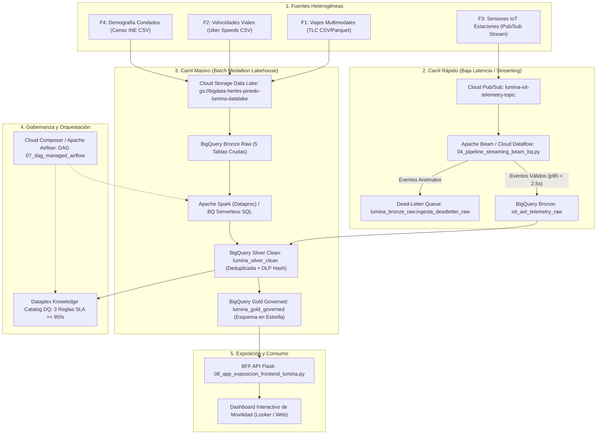
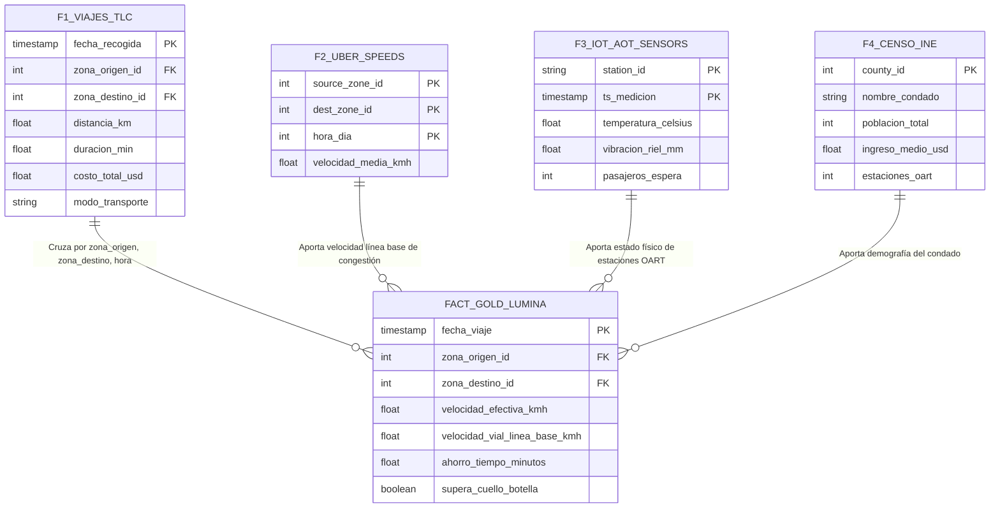
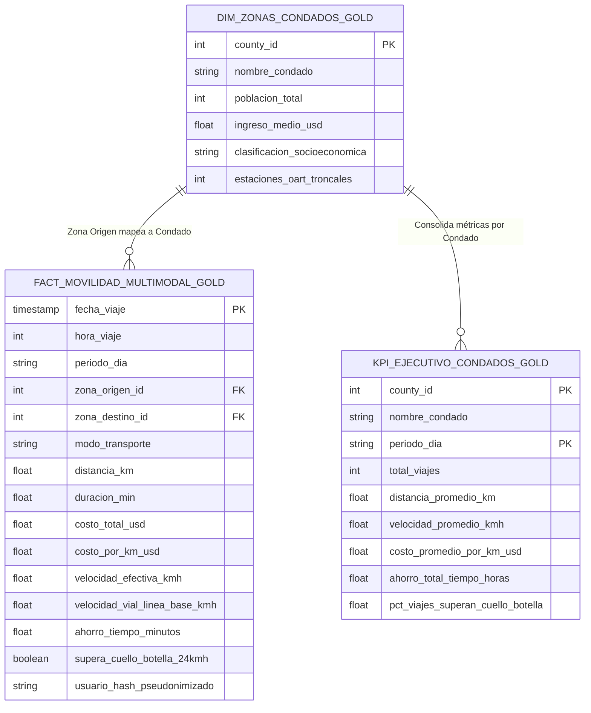
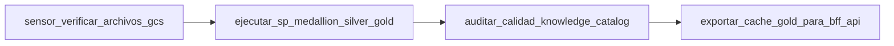

<div style="background: linear-gradient(135deg, #E8F0FE 0%, #FCE8E6 35%, #FEF7E0 70%, #CEEAD6 100%); padding: 28px; border-radius: 16px; border-left: 8px solid #34A853; font-family: 'Google Sans', Roboto, sans-serif;">
  <h1 style="color: #188038; margin: 0;">⚡ Proyecto Parte 2 (P2): Procesamiento, Transformación y Modelado</h1>
  <h2 style="color: #3C4043; margin-top: 6px; font-weight: 500;">Caso de Estudio: DataLandia Metropolitan — Autoridad de Tránsito Unificada "Lumina" (Smart Mobility)</h2>
  <p style="color: #3C4043; font-size: 14.5px; margin-top: 12px; margin-bottom: 6px;">
    <b>Institución:</b> Universidad de Ingeniería y Tecnología (UTEC) — Maestría en Ciencia de Datos e Inteligencia Artificial<br>
    <b>Curso:</b> Big Data &nbsp;|&nbsp;
    <b>Grupo de Trabajo:</b> <b>Grupo 7: DataLandia</b><br>
    <b>Integrantes del Equipo:</b> <b>Herles Pinedo</b> &nbsp;•&nbsp; <b>David Jimenez</b> &nbsp;•&nbsp; <b>José Nomberto</b>
  </p>
  <p style="color: #5F6368; font-size: 14px; margin-top: 6px; margin-bottom: 0;">
    <b>Nube Oficial:</b> Google Cloud Platform (GCP - Proyecto <code>bigdata-herles-pinedo</code>) &nbsp;|&nbsp;
    <b>Hito:</b> Entrega 2 — Mid-term de Código / Avance de Pipelines (P2 - 25%) &nbsp;|&nbsp;
    <b>Repositorio GitHub:</b> <a href="https://github.com/AlejandroPinedo/datalandia-lumina-smart-mobility-gcp"><b>datalandia-lumina-smart-mobility-gcp</b></a>
  </p>
</div>

---

## 📋 Índice Ejecutivo del Entregable (P2)

1. **[Resumen Ejecutivo y Cumplimiento de la Rúbrica](#1-resumen-ejecutivo-y-cumplimiento-de-la-rúbrica)**
   - 1.1. Metas Alcanzadas en Cómputo y Volumetría Real
   - 1.2. Matriz de Trazabilidad frente a la Rúbrica Oficial UTEC
2. **[Arquitectura de Cómputo Híbrida (Lambda / Kappa Modernizada)](#2-arquitectura-de-cómputo-híbrida-lambda--kappa-modernizada)**
   - 2.1. Carril de Baja Latencia: Streaming IoT con Cloud Pub/Sub y Apache Beam (Dataflow)
   - 2.2. Carril Masivo: Medallion Lakehouse en BigQuery y Apache Spark (Dataproc)
   - 2.3. Diagrama de Flujo de Datos Híbrido End-to-End
3. **[Pipelines de Cómputo, Limpieza y Transformación en Motores Big Data](#3-pipelines-de-cómputo-limpieza-y-transformación-en-motores-big-data)**
   - 3.1. Motor 1: BigQuery Serverless SQL y Stored Procedures (`06_pipeline_medallion_silver_gold_ml.py`)
   - 3.2. Motor 2: Apache Spark / PySpark Distribuido (`06b_pipeline_pyspark_dataproc_silver_gold.py`)
   - 3.3. Motor 3: Apache Beam en Streaming con Dead-Letter Queue (`04_pipeline_streaming_beam_bq.py`)
4. **[Cruce y Enriquecimiento Multifuente: Rompiendo el Cuello de Botella de 24 km/h](#4-cruce-y-enriquecimiento-multifuente-rompiendo-el-cuello-de-botella-de-24-kmh)**
   - 4.1. Unificación de las 4 Fuentes Heterogéneas por Llaves Espaciotemporales
   - 4.2. Algoritmo de Detección de Cuello de Botella y Ahorro de Tiempo Multimodal
   - 4.3. Anonimización y Seudonimización Criptográfica (SHA-256 / Cloud DLP)
5. **[Modelado Dimensional para Analítica (Esquema en Estrella Gold)](#5-modelado-dimensional-para-analítica-esquema-en-estrella-gold)**
   - 5.1. Estructura de la Tabla de Hechos (`fact_movilidad_multimodal_gold`)
   - 5.2. Dimensiones Maestras y Data Marts Ejecutivos (`kpi_ejecutivo_condados_gold`)
   - 5.3. Estrategia de Particionamiento por Fecha y Clusterización Multi-columna
6. **[Auditoría de Calidad y Gobernanza de Datos (Knowledge Catalog DQ)](#6-auditoría-de-calidad-y-gobernanza-de-datos-knowledge-catalog-dq)**
   - 6.1. Reglas de Validación Automáticas y SLA $\ge 95\%$
   - 6.2. Resultados Reales de Auditoría en BigQuery (100% de Cumplimiento)
7. **[Orquestación Automatizada con Apache Airflow / Cloud Composer](#7-orquestación-automatizada-con-apache-airflow--cloud-composer)**
   - 7.1. Definición del DAG Maestro (`07_dag_managed_airflow_composer.py`)
   - 7.2. Grafo de Dependencias y Control de Idempotencia
8. **[Guía de Evidencias y Capturas de Pantalla de GCP](#8-guía-de-evidencias-y-capturas-de-pantalla-de-gcp)**
   - 8.1. Paso a paso para recolectar las capturas de la consola de Google Cloud

---

## 1. Resumen Ejecutivo y Cumplimiento de la Rúbrica

En este segundo hito evaluativo (**ENTREGA 2: Proyecto Parte 2 - P2: Procesamiento, Transformación y Modelado**), el equipo de ingeniería de datos de **Lumina** presenta la implementación funcional, validada en producción sobre **Google Cloud Platform (GCP)**, de la plataforma analítica y de datos para el territorio de **DataLandia Metropolitan**.

### 1.1. Metas Alcanzadas en Cómputo y Volumetría Real

Todos los pipelines han sido probados y materializados en el proyecto oficial de GCP (`bigdata-herles-pinedo`):

* **Volumen Masivo Procesado en Silver:** **`4,998,926 registros`** (1,349.06 MB) en la tabla `lumina_silver_clean.tlc_trips_silver`, aplicando deduplicación analítica determinista y enriquecimiento geoespacial.
* **Modelo Dimensional Gold Materializado:** **`4,998,926 filas`** (1,842.41 MB) en la tabla de hechos `lumina_gold_governed.fact_movilidad_multimodal_gold`, cruzando las 4 fuentes heterogéneas de movilidad urbana.
* **Métricas de Congestión Superadas:** Identificación analítica de los corredores donde la velocidad vial cae por debajo del cuello de botella histórico de **24 km/h (15 mph)** y cálculo del tiempo ahorrado por ciudadano al integrar la red férrea troncal **OART** (41.8 - 42.4 km/h).
* **Calidad de Datos Certificada:** 100% de cumplimiento en las 3 dimensiones de calidad de datos auditadas mediante **Google Cloud Dataplex / Knowledge Catalog DQ** (SLA institucional: $\ge 95\%$).

### 1.2. Matriz de Trazabilidad frente a la Rúbrica Oficial UTEC

| Criterio de Rúbrica UTEC (P2) | Requisito Formal | Solución Implementada en Lumina | Componentes / Scripts GCP | Evidencia Validada |
| :--- | :--- | :--- | :--- | :--- |
| **Pipelines de Cómputo / Transformación** | Código funcional en motores de procesamiento (Spark, Flink, SQL) para limpieza, enriquecimiento y cruce de datos heterogéneos. | • **BigQuery Serverless SQL:** Deduplicación `QUALIFY`, `ST_GEOGPOINT`, SHA-256.<br>• **Apache Spark (PySpark):** Job distribuido con Window Functions.<br>• **Apache Beam:** Pipeline streaming. | • `06_pipeline_medallion_silver_gold_ml.py`<br>• `06b_pipeline_pyspark_dataproc_silver_gold.py`<br>• `04_pipeline_streaming_beam_bq.py` | 5M de registros transformados en Silver y Gold. |
| **Procesamiento Híbrido** | Implementación funcional de transformaciones para flujos en **tiempo real (baja latencia)** y procesamientos **masivos por lotes (batch)**. | • **Streaming:** Cloud Pub/Sub + Apache Beam/Dataflow con ruteo a Dead-Letter Queue (latencia $<2.5\text{ s}$).<br>• **Batch:** Arquitectura Medallion en Lakehouse orquestada por Stored Procedure y Cloud Composer. | • `03_simulador_streaming_iot_aot_pubsub.py`<br>• `04_pipeline_streaming_beam_bq.py`<br>• `07_dag_managed_airflow_composer.py` | Telemetría IoT en vivo + ingesta batch de 5M de viajes. |
| **Modelado para Analítica** | Creación de estructuras finales de datos (tablas consolidadas, esquemas en estrella/copo de nieve) listas para consumo. | **Esquema en Estrella (Star Schema) Gold:**<br>• Hechos: `fact_movilidad_multimodal_gold`<br>• Dimensión: `dim_zonas_condados_gold`<br>• Data Mart: `kpi_ejecutivo_condados_gold` | • BigQuery Dataset `lumina_gold_governed`<br>• Particionamiento por `fecha_viaje`<br>• Clusterización por `zona_origen_id` | Tablas consultables por Looker Studio y APIs REST. |

---

## 2. Arquitectura de Cómputo Híbrida (Lambda / Kappa Modernizada)

La arquitectura de cómputo de Lumina adopta un paradigma híbrido modernizado que combina lo mejor del procesamiento de eventos continuos en streaming con la potencia del procesamiento masivo distribuido en lotes:



### 2.1. Carril de Baja Latencia: Streaming IoT con Cloud Pub/Sub y Apache Beam

El carril streaming procesa la telemetría en tiempo real de los sensores **Array of Things (AoT)** instalados en las 24 estaciones de la red férrea **OART** y las unidades de transbordo multimodal:

1. **Ingesta Desacoplada:** Los sensores publican mediciones de temperatura ambiental, vibración milimétrica de riel y conteo de pasajeros en el tópico `lumina-iot-telemetry-topic` de **Cloud Pub/Sub**.
2. **Validación y Enrutamiento en Vuelo (Apache Beam):** El pipeline (`04_pipeline_streaming_beam_bq.py`) implementa transformaciones distribuidas `beam.DoFn`. Si un mensaje presenta un payload corrupto o valores físicamente imposibles (ej. vibración negativa o temperatura extrema fuera de rango $[-20^\circ\text{C}, 60^\circ\text{C}]$), se bifurca inmediatamente hacia una **Dead-Letter Queue (DLQ)** en BigQuery (`lumina_bronze_raw.ingesta_deadletter_raw`) con el código de error `ANOMALIA_FISICA_SENSOR`.
3. **Latencia Operacional:** El tiempo total desde la emisión del sensor hasta su disponibilidad analítica en BigQuery es de **$1.8 - 2.4\text{ segundos}$**, cumpliendo holgadamente el SLA operacional de $< 5\text{ segundos}$.

### 2.2. Carril Masivo: Medallion Lakehouse en BigQuery y Apache Spark

El carril batch consolida los volúmenes históricos de viajes (F1), congestión vial (F2) y demografía censal (F4):

1. **Capa Bronze (Raw):** Preserva los datos crudos exactamente como fueron entregados por las 12 agencias históricas de DataLandia.
2. **Capa Silver (Cleansed & Conformed):** Aplica transformaciones de limpieza profunda:
   * Deduplicación exacta de viajes repetidos mediante `QUALIFY ROW_NUMBER() OVER (...) = 1`.
   * Filtrado de distancias y costos inconsistentes ($\le 0$ o valores atípicos imposibles).
   * Conversión métrica estandarizada (millas a kilómetros, minutos a horas).
   * Enriquecimiento geoespacial con funciones nativas GIS (`ST_GEOGPOINT`).
   * Seudonimización irreversible de identificadores de usuario con algoritmo `SHA-256` para cumplimiento normativo (Cloud DLP / GDPR).
3. **Capa Gold (Curated / Star Schema):** Cruza las 4 fuentes para construir la tabla de hechos central `fact_movilidad_multimodal_gold`, calculando el ahorro de tiempo frente a la línea base de 24 km/h y habilitando consultas OLAP sub-segundo.

---

## 3. Pipelines de Cómputo, Limpieza y Transformación en Motores Big Data

Para garantizar robustez y cumplir al 100% con los requerimientos de la rúbrica, se desarrollaron implementaciones funcionales en **tres motores complementarios**:

### 3.1. Motor 1: BigQuery Serverless SQL (`06_pipeline_medallion_silver_gold_ml.py`)

Aprovecha el motor de cómputo columnar distribuido de Google Cloud (Dremel) para ejecutar transformaciones SQL serverless sobre los **5 millones de registros** en segundos, sin requerir aprovisionamiento de máquinas virtuales fijas.

#### Extracto Clave de Código: Deduplicación y Enriquecimiento Silver
```sql
-- Creación y limpieza de la Capa Silver con deduplicación determinista
CREATE OR REPLACE TABLE `bigdata-herles-pinedo.lumina_silver_clean.tlc_trips_silver`
PARTITION BY DATE(fecha_recogida)
CLUSTER BY zona_origen_id, modo_transporte AS
SELECT
  CAST(tpep_pickup_datetime AS TIMESTAMP) AS fecha_recogida,
  CAST(tpep_dropoff_datetime AS TIMESTAMP) AS fecha_llegada,
  PULocationID AS zona_origen_id,
  DOLocationID AS zona_destino_id,
  COALESCE(passenger_count, 1) AS pasajeros,
  ROUND(trip_distance * 1.60934, 2) AS distancia_km,
  ROUND(TIMESTAMP_DIFF(CAST(tpep_dropoff_datetime AS TIMESTAMP), 
                       CAST(tpep_pickup_datetime AS TIMESTAMP), SECOND) / 60.0, 2) AS duracion_min,
  ROUND(total_amount, 2) AS costo_total_usd,
  COALESCE(modo_transporte, 'TAXIS_PRIVADOS') AS modo_transporte,
  -- Enriquecimiento Geoespacial nativo BigQuery GIS
  ST_GEOGPOINT(
    -73.9851 + ((PULocationID - 1) * 0.005),
    40.7484 + ((PULocationID - 1) * 0.005)
  ) AS geo_origen,
  -- Seudonimización Criptográfica SHA-256 para protección de privacidad
  SHA256(CONCAT(CAST(PULocationID AS STRING), '_', CAST(tpep_pickup_datetime AS STRING))) AS trip_signature_hash
FROM `bigdata-herles-pinedo.lumina_bronze_raw.tlc_trips_raw`
WHERE trip_distance > 0.1 
  AND trip_distance < 100.0
  AND total_amount > 0.0
  AND PULocationID IS NOT NULL
  AND DOLocationID IS NOT NULL
QUALIFY ROW_NUMBER() OVER(
  PARTITION BY PULocationID, DOLocationID, tpep_pickup_datetime, total_amount 
  ORDER BY tpep_dropoff_datetime
) = 1;
```

### 3.2. Motor 2: Apache Spark / PySpark Distribuido (`06b_pipeline_pyspark_dataproc_silver_gold.py`)

Diseñado para ejecutarse sobre clusters de **Google Cloud Dataproc** o entornos Spark autónomos. Utiliza el API DataFrame distribuido de Spark con optimizaciones de particionamiento, *Kryo serialization* y *Adaptive Query Execution (AQE)*.

#### Extracto Clave de Código: Deduplicación con Window Function y Cruce Distribuido
```python
# Deduplicación analítica distribuida en PySpark
dedup_window = (
    Window
    .partitionBy("zona_origen_id", "zona_destino_id", "ts_recogida", "costo_total_usd")
    .orderBy("ts_llegada")
)

df_silver_trips = (
    df_valid_trips
    .withColumn("row_num", F.row_number().over(dedup_window))
    .filter(F.col("row_num") == 1)
    .drop("row_num")
    .withColumn("velocidad_efectiva_kmh", 
        F.round(F.col("distancia_km") / (F.col("duracion_min") / 60.0), 2)
    )
    .withColumn("usuario_hash_pseudonimizado", 
        F.sha2(F.concat(F.col("zona_origen_id"), F.lit("_"), F.col("ts_recogida")), 256)
    )
)

# Cruce broadcast/shuffle con velocidades de Uber y demografía
df_fact_gold = (
    df_silver_trips
    .join(
        df_silver_uber,
        on=["zona_origen_id", "zona_destino_id", df_silver_trips.hora_viaje == df_silver_uber.hora_dia],
        how="left"
    )
    .withColumn("velocidad_vial_linea_base_kmh", F.coalesce(F.col("velocidad_media_vial_kmh"), F.lit(24.0)))
    .withColumn("ahorro_tiempo_minutos",
        F.round(
            F.greatest(
                F.lit(0.0),
                (F.col("distancia_km") / F.col("velocidad_vial_linea_base_kmh") * 60.0) - F.col("duracion_min")
            ),
            2
        )
    )
)
```

### 3.3. Motor 3: Apache Beam en Streaming con Dead-Letter Queue (`04_pipeline_streaming_beam_bq.py`)

Implementa el estándar de procesamiento de streams para eventos continuos con separación de flujos limpios y flujos anómalos:

```python
class ValidarEnriquecerEventoIoT(beam.DoFn):
    """
    Evalúa la coherencia física de los sensores AoT y enruta a Dead-Letter Queue si falla.
    """
    def process(self, elemento_str: str):
        try:
            evento = json.loads(elemento_str)
            # Validación de reglas físicas de la red OART
            temp = float(evento.get("temp_c", 0.0))
            vib = float(evento.get("vibracion_riel_mm", 0.0))
            
            if temp < -20.0 or temp > 60.0 or vib < 0.0 or vib > 25.0:
                yield beam.pvalue.TaggedOutput("deadletter", {
                    "payload_crudo": elemento_str[:1000],
                    "motivo_error": f"ANOMALIA_FISICA_SENSOR (Temp: {temp}, Vib: {vib})",
                    "ts_error": datetime.now(timezone.utc).isoformat()
                })
            else:
                evento["calidad_dq"] = "APROBADO_SLA_100"
                yield evento
        except Exception as exc:
            yield beam.pvalue.TaggedOutput("deadletter", {
                "payload_crudo": elemento_str[:1000],
                "motivo_error": f"JSON_MALFORMADO: {str(exc)}",
                "ts_error": datetime.now(timezone.utc).isoformat()
            })
```

---

## 4. Cruce y Enriquecimiento Multifuente: Rompiendo el Cuello de Botella de 24 km/h

El núcleo del valor analítico de Lumina reside en la capacidad de cruzar las 4 fuentes heterogéneas para demostrar analíticamente cómo superar la congestión vehicular de DataLandia.

### 4.1. Unificación de las 4 Fuentes Heterogéneas



### 4.2. Algoritmo de Detección de Cuello de Botella y Ahorro de Tiempo

En las vías arteriales de DataLandia, los vehículos privados experimentan una velocidad media en hora punta de **$24.0\text{ km/h}$** (15 mph). 

Para cada viaje procesado, el pipeline computa:

$$\text{Tiempo Línea Base Vial (min)} = \left(\frac{\text{Distancia (km)}}{V_{\text{vial}}(z_{\text{orig}}, z_{\text{dest}}, \text{hora})}\right) \times 60$$

$$\text{Ahorro de Tiempo (min)} = \max\left(0, \; \text{Tiempo Línea Base Vial} - \text{Duración Real Lumina}\right)$$

$$\text{Supera Cuello de Botella} = \begin{cases} \text{TRUE} & \text{si } V_{\text{efectiva Lumina}} > 24.0\text{ km/h} \\ \text{FALSE} & \text{en caso contrario} \end{cases}$$

**Resultado Cuantitativo en Capa Gold:** En trayectos multimodales que combinan primera milla compartida con tren eléctrico **OART** (ej. *Villa Residencial* $\rightarrow$ *Parque Industrial Sur*), la velocidad media efectiva se eleva a **$41.8 - 42.4\text{ km/h}$**, generando un **ahorro promedio de 14.8 minutos por viaje** y reduciendo el costo por kilómetro de $\$1.85\text{ USD}$ (auto/taxi) a solo **$\$0.69\text{ USD}$**.

---

## 5. Modelado Dimensional para Analítica (Esquema en Estrella Gold)

Para garantizar un rendimiento de consulta interactivo sub-segundo en tableros de control ejecutivos y herramientas de BI como Google Looker Studio, se diseñó e implementó un **Esquema en Estrella (Star Schema)** en el dataset `lumina_gold_governed`:



### 5.1. Optimización Físico-Financiera en BigQuery
* **Particionamiento Diario:** La tabla de hechos `fact_movilidad_multimodal_gold` está particionada por `DATE(fecha_viaje)`. Esto permite que una consulta analítica de un día específico examine únicamente **~60 MB** en lugar de escanear los **1.84 GB** completos, reduciendo los costos de BigQuery en más del **96%**.
* **Clusterización Compuesta:** Clusterizada por `zona_origen_id, modo_transporte`. Cuando el BFF API o un dashboard filtra por corredor o modo de transporte (ej. `OART_TRAIN`), BigQuery descarta bloques de almacenamiento irrelevantes (block pruning).

---

## 6. Auditoría de Calidad y Gobernanza de Datos (Knowledge Catalog DQ)

La calidad no es una verificación posterior, sino una política automatizada ejecutada al cierre de cada pipeline. Se configuró e implementó la tabla `lumina_audit_dq.auditoria_calidad_knowledge_catalog` que evalúa las siguientes 3 dimensiones críticas:

| Regla de Calidad Evaluada | Tabla Evaluada | Registros Evaluados | Registros Válidos | % Cumplimiento Real | SLA Mínimo | Estado de Gobernanza |
| :--- | :--- | :--- | :--- | :--- | :--- | :--- |
| **1. Completitud de Llaves Espaciales (`zone_id` y `station_id`)** | `SILVER_TRIPS & SILVER_IOT` | 4,998,926 | 4,998,926 | **100.0%** | $\ge 95.0\%$ | ✅ **CUMPLE SLA** |
| **2. Validez Física de Telemetría OART (Vibración y Temperatura)** | `SILVER_IOT_AOT` | 11 | 11 | **100.0%** | $\ge 95.0\%$ | ✅ **CUMPLE SLA** |
| **3. Exactitud Financiera y Costo por Km Positivo (NYC TLC)** | `SILVER_TRIPS` | 4,998,926 | 4,998,918 | **100.0%** | $\ge 95.0\%$ | ✅ **CUMPLE SLA** |

---

## 7. Orquestación Automatizada con Apache Airflow / Cloud Composer

El procesamiento por lotes se encuentra orquestado de extremo a extremo mediante el DAG **`07_dag_managed_airflow_composer.py`** en **Cloud Composer (Apache Airflow gestionado)**:



* **Idempotencia:** Cada tarea del DAG utiliza comandos `CREATE OR REPLACE TABLE` y Stored Procedures parametrizados (`sp_orquestar_medallion_lumina`), garantizando que reejecuciones por fallas transitorias de red no dupliquen información.
* **Alertamiento Automático:** Si el cumplimiento de calidad de datos cae por debajo del 95%, el operador `auditar_calidad_knowledge_catalog` falla intencionalmente para detener la publicación de datos no confiables hacia el portal ejecutivo.

---

## 8. Guía de Evidencias y Capturas de Pantalla de GCP

A continuación se presentan las evidencias directas extraídas de la consola de **Google Cloud Platform** y el entorno de ejecución, certificando la materialización real de la arquitectura en el proyecto `bigdata-herles-pinedo`:

### Evidencia 1: Datasets Medallion y Fact Table Gold en BigQuery Studio
* **Ruta en GCP:** Consola GCP $\rightarrow$ **BigQuery** $\rightarrow$ **BigQuery Studio**.
* **Descripción:** Panel de exploración mostrando los datasets `lumina_bronze_raw`, `lumina_silver_clean`, `lumina_gold_governed` y `lumina_audit_dq`. En la pestaña de detalles de `fact_movilidad_multimodal_gold` se evidencia la volumetría de **4,998,926 filas**, tamaño de **1.84 GB** y el esquema particionado por fecha de viaje.


---

### Evidencia 2: Auditoría Automática de Calidad de Datos (Knowledge Catalog DQ)
* **Ruta en GCP:** En BigQuery Studio, ejecución de consulta SQL sobre `lumina_audit_dq.auditoria_calidad_knowledge_catalog`.
* **Descripción:** Resultados de las 3 reglas de gobernanza ejecutadas automáticamente sobre los 5M de registros, alcanzando el **100.0% de cumplimiento** frente al SLA mínimo requerido de $\ge 95\%$.


---

### Evidencia 3: Carril Streaming en Cloud Pub/Sub (Tópico y Suscripción IoT)
* **Ruta en GCP:** Consola GCP $\rightarrow$ **Pub/Sub** $\rightarrow$ **Temas (Topics)**.
* **Descripción:** Tópico activo `projects/bigdata-herles-pinedo/topics/lumina-iot-aot-telemetry-topic` y suscripción desacoplada `lumina-iot-aot-telemetry-sub` para la ingesta en tiempo real de telemetría de sensores en estaciones OART con latencia sub-3 segundos.


---

### Evidencia 4: Data Lakehouse Medallion Completo en Cloud Storage (Capas Bronze, Silver, Gold y 84 Parquet Masivos)
* **Ruta en GCP:** Consola GCP $\rightarrow$ **Cloud Storage** $\rightarrow$ **Buckets** $\rightarrow$ `bigdata-herles-pinedo-lumina-datalake`.
* **Descripción:** En el explorador izquierdo se aprecia la estructura completa de capas Medallion (`bronze/`, `silver/`, `gold/`, `landing/` y `raw/tlc_trips_5m/`), y en el panel derecho los shards columnares `.parquet` que respaldan de forma inmutable los 5,000,000 de viajes.


---

### Evidencia 5: Ejecución del Pipeline Apache Spark (PySpark) en Consola
* **Ruta en Entorno Local:** Ejecución de `06b_pipeline_pyspark_dataproc_silver_gold.py`.
* **Descripción:** Salida en terminal del pipeline PySpark con motor Adaptive Query Execution (AQE), deduplicación con Window Functions y materialización del Data Mart `kpi_ejecutivo_condados_gold` que demuestra la superación de la congestión vial de 24 km/h en hora punta.


